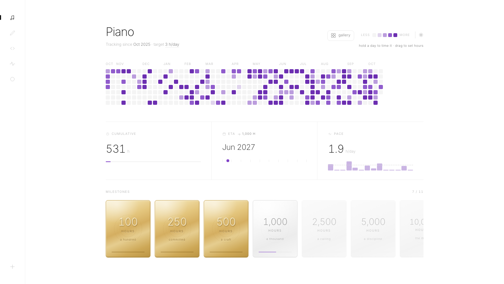
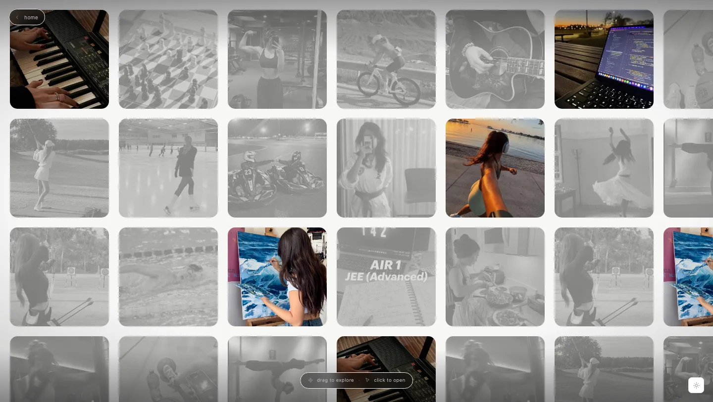
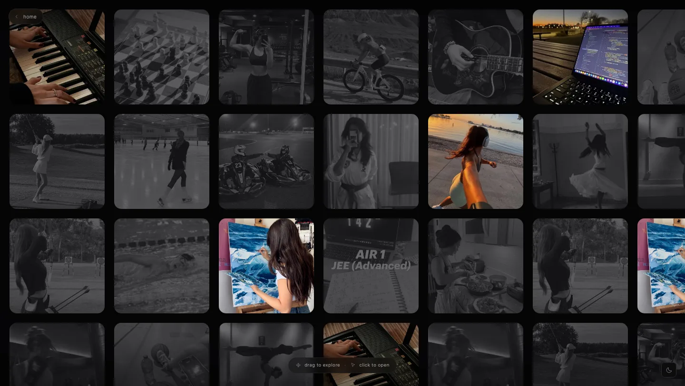
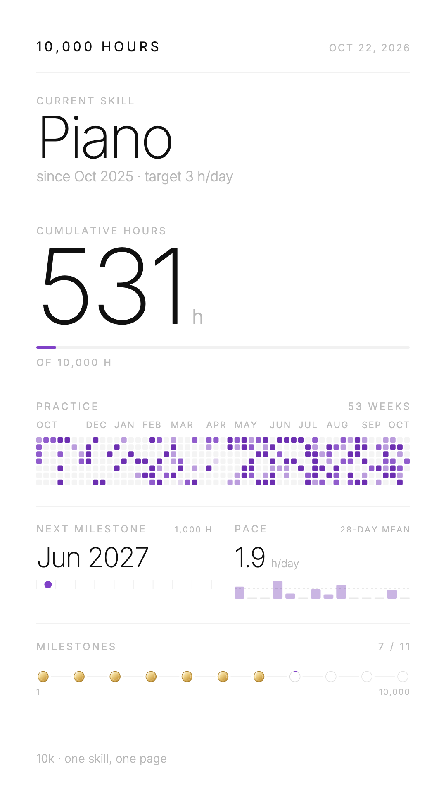
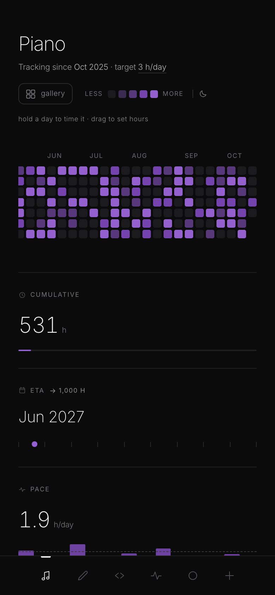

<div align="center">


# Why I built 10,000 Hours

_(and why the number is not the point)_

</div>

I built this because I kept mistaking the feeling of starting for the work of continuing. The first week is loud: a new notebook, a new setup, a plan with too many columns. Then life returns, and the plan becomes a reminder of the person I was briefly sure I'd become.

What survives is not motivation. It is the quiet decision to show up again — for twenty minutes, for one square, for a number small enough to be honest.

**10,000 Hours is not a productivity dashboard.** It is a small instrument for that decision. One skill, one page. A year of days you can actually see. Three numbers: how much you have done, when you reach the next milestone at your current pace, and whether that pace is moving.

It does not sync. It does not send notifications. It does not turn your practice into a leaderboard. It just keeps the distance visible, so the days you show up have somewhere to go.

Because when the initial excitement is gone, the only useful question is: _am I still moving?_

10,000 Hours answers without applause: **yes. one more square.**

<br />

<picture>
  <source media="(prefers-color-scheme: dark)" srcset="docs/app-dark.png" />
  
</picture>

<div align="center">
<sub>The console. One skill, one year, three numbers.</sub>
</div>

<br />

[](https://abhinav-prabhakar.github.io/10k/)
[](https://abhinav-prabhakar.github.io/10k/gallery.html)
[](design.md)

---

## The instrument

A GitHub-style contribution graph, 53 weeks wide, one cell per day. Colour intensity is relative to *that skill's* daily target, so a cell at level 3 always means “on cadence”, whatever the skill.

Click a day to log hours. Hold it to start a stopwatch. Drag vertically to set the whole day in one gesture. The graph is the date picker; there is no separate form.

Below it, three numbers:

- **Cumulative** — hours done, with a hairline bar toward the horizon.
- **ETA** — the month and year you reach the *next* milestone at your current pace.
- **Pace** — h/day over the last 28 days, including zero days.

Pace includes the zeros on purpose. One heroic weekend should not be allowed to flatter the projection. The ETA is allowed to be disappointing; that is what makes it useful.

The milestone row is the only ornament. Eleven thresholds, struck gold when crossed. Nothing is awarded for showing up. Every card marks hours the graph already counts.

---

## The gallery

A visual index for the hobbies that could become practices. Twenty photographs, one draggable field. The skills you already track keep their colour and open their page. Everything else waits in greyscale, marked `soon`.

<table>
<tr>
<td width="50%"></td>
<td width="50%"></td>
</tr>
<tr>
<td align="center"><sub>Light</sub></td>
<td align="center"><sub>Dark</sub></td>
</tr>
</table>

---

## A card worth posting

Hold the skill title — or focus it and press <kbd>⇧</kbd><kbd>↵</kbd> — and the page composes a **1080 × 1920** poster: the year's graph, cumulative hours, the next milestone, pace, and the gold thresholds. It downloads as a PNG.

It reads the live theme, so a dark console produces a dark card. A still image, designed for a story — not a screenshot of the interface.

<table>
<tr>
<td width="300" valign="top"></td>
<td valign="top">

**Quiet on approach.** The hint only appears on hover or focus. A short click is still just a click.

**Same colour system.** Ink and hairlines for every word; the skill hue only in data ink; gold only in the milestones.

**Phone first.** Exactly 1080 × 1920. No browser chrome, no URL, no QR clutter.

</td>
</tr>
</table>

---

## Microskills

Not every practice is aiming at ten thousand hours. Hold <kbd>⌘</kbd> (macOS) or <kbd>Ctrl</kbd> (Windows/Linux) while clicking the rail's add button, and the same dialog opens with a **1,000-hour** goal.

The page is the same instrument. The bar, ETA, completion copy, and milestone row all read the skill's own horizon. The row simply ends at `1,000`. No special badge, no second accent, no smaller version of the product.

---

## Yours, locally

Your practice is a file you can read, not a metric inside someone else's product. Skills, logs, targets, the active skill, and each skill's horizon live in `localStorage` under `tenk.v1`. A corrupt payload is backed up and reseeded; storage failures never throw. The theme preference lives separately under `tenk.theme`.

There is no account, no server, and no tracking. A running stopwatch is still written only when the session is logged or discarded.

---

## Run it

```bash
git clone https://github.com/Abhinav-Prabhakar/10k.git
cd 10k
open index.html
```

That is the whole setup. For the localStorage contract and the Node tests:

```bash
python3 -m http.server 8899
node store.test.js
```

Open <http://localhost:8899>.

**Live:** <https://abhinav-prabhakar.github.io/10k/> — GitHub Pages, `main`, root. No build step.

<details>
<summary><strong>Keyboard shortcuts</strong></summary>

<br />

| Keys | Action |
|:--|:--|
| <kbd>⌘</kbd><kbd>K</kbd> / <kbd>Ctrl</kbd><kbd>K</kbd> | Command palette |
| <kbd>?</kbd> | Shortcut cheatsheet |
| <kbd>↑</kbd> <kbd>↓</kbd> / <kbd>←</kbd> <kbd>→</kbd> | Previous / next skill |
| <kbd>1</kbd>–<kbd>9</kbd> | Jump to skill |
| <kbd>N</kbd> | New skill |
| <kbd>⌘</kbd><kbd>⇧</kbd><kbd>N</kbd> / <kbd>Ctrl</kbd><kbd>⇧</kbd><kbd>N</kbd> | New microskill |
| <kbd>T</kbd> | Edit the daily target |
| <kbd>L</kbd> | Log today |
| <kbd>S</kbd> | Start / stop today's session |
| <kbd>D</kbd> | Delete this skill |
| <kbd>⌘</kbd><kbd>⇧</kbd><kbd>L</kbd> / <kbd>Ctrl</kbd><kbd>⇧</kbd><kbd>L</kbd> | Cycle auto → light → dark |
| <kbd>Esc</kbd> | Close the topmost surface |

</details>

<br />

<p align="center">
  
</p>

---

## Design

The full system lives in [`design.md`](design.md): tokens, type scale, motion, data semantics, accessibility floors, and the reasons behind each surface. White canvas, Inter at 100–300, hairlines instead of cards, one hue per skill, one easing curve. Dark mode is the same instrument after dark.

Built with vanilla HTML, CSS, and JavaScript. No framework, no bundler, no tracking.

<div align="center">

**Ten thousand hours is not a deadline. It's a direction.**

</div>
